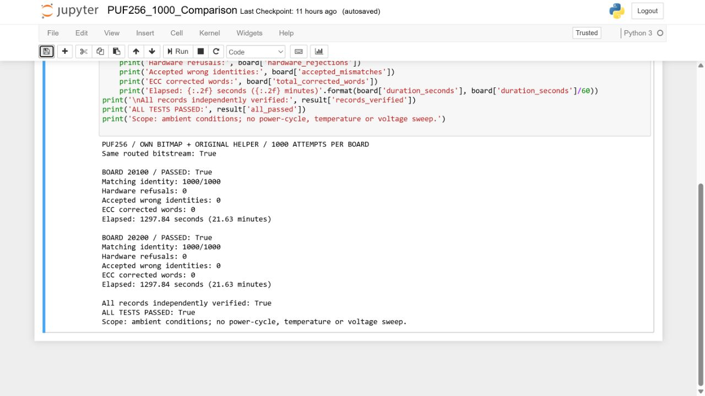

# 驗證總結與證據索引

正式來源是十個已驗證 RTL，hash 見 SOURCE_MANIFEST。以下為歷史實際結果，不把提供腳本等同執行通過；本次整理的新檢查另見 [HANDOFF_CHECKS](HANDOFF_CHECKS.md)。

|階段|實際結果|原始證據|
|---|---|---|
|功能模擬|完整波形/真實Counter、count核心、ECC回歸通過|[simulation](results/single_board/simulation)|
|原FPGA實作|WNS +0.145ns、WHS +0.061ns、pulse +0.500ns；640 Gray bus最大skew3.323ns<8ns；234 methodology完成、無非預期finding|[報告](results/single_board/vivado)、[時序說明](TIMING_CLOSURE.md)|
|各板專屬bitmap基準|20100/20200各111/111重建成功，修正0|[雙板baseline資料](results/two_boards/sample_results)|
|共同bitmap雙板|身份碼相差72/256bit（28.125%）；20100成功111，20200成功62、弱配對拒絕49，成功身份均一致|[原報告](results/two_boards/RESULTS.original.md)、[原紀錄](results/two_boards/sample_results/two_board_comparison.json)|
|各板專屬bitmap千次|兩板各1000/1000成功，零拒絕、零身份碼改變、零ECC修正，耗時各約1297.84s|[原報告](results/rebuild_1000/RESULTS.original.md)、[逐筆與核對](results/rebuild_1000/sample_results)|

共同bitmap實驗與每板專屬bitmap實驗是不同問題。共同實驗第二板的49次拒絕不能刪掉，也不能把之後專屬bitmap成功寫成共同bitmap可靠度已修好。首次失敗後有診斷暫停，固定111次結果不是不間斷/受控BER實驗。

原單板bit SHA256：`79346d7855c4a678563e8010083456b762b63bc8a8455388b2c45d4f12b7c7c2`。HWH/原source資訊見 [original_board_manifest](results/single_board/original_board_manifest.json)。現在的重新打包/重建需重新取得bit hash與量測結果。

## 原始證據保存原則

results內 `*.original.md`、sample_results、provenance、evidence、frozen、inputs 保留原始內容。原md中的舊路徑及指令只供溯源，不是正式操作入口。原報告的圖片可由各實驗sample_results中的同名PNG查看。

1000次的attempts.jsonl包含實際硬體輸出、sequence、status、correction、bitmap/helper讀回與時間；ZIP、Notebook snapshot及整理後Notebook一起保留。實驗身份碼是公開的測試資料，不可當成正式部署密鑰。

從src/sysVerilog/PUF_TRNG/PUF執行 `python3 verification/recheck_evidence.py`，會由原始CSV/JSONL獨立核對baseline、重選規則、凍結輸入、helper、輸出與排程。結果寫入build，不覆寫原始證據。可回報 records_verified=true 與 passed=false；前者不是把失敗改成成功。

## 開發歷程

RO8、RO32、RO320階段的原md在history；先由少量RO確認量測，再擴充到320組、做篩選，最後整合PUF/ECC/AXI。RO32曾有弱配對，負面觀察也保留。不同設計/不同階段的測量數不能直接相加成最終設計的總驗證次數。

未測及安全邊界統一見 [LIMITATIONS](LIMITATIONS.md)。

原始timing_summary與bus_skew體積較大，以`.rpt.gz`無損保存，原始bytes/hash見同目錄COMPRESSED_REPORTS.json。recheck_evidence會解壓到build後重新執行報告檢查，不覆寫Git中的證據。
