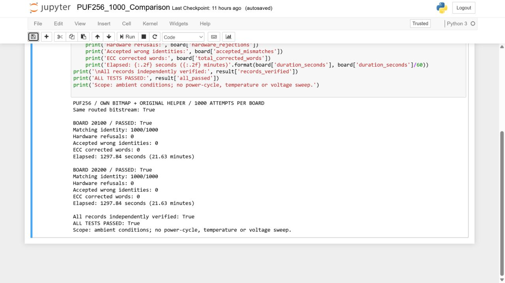

# 各板專屬 bitmap/helper：1000 次重建結果

本地日期：2026-11-13。兩塊板各執行固定 1000 次硬體重建，使用原專屬 bitmap 與 helper；不重新註冊、不換樣、不以成功次數作為停止條件。

| 項目 | 20100 | 20200 |
|---|---:|---:|
| 重建嘗試 | 1000 | 1000 |
| 成功且身份碼與原註冊一致 | 1000 | 1000 |
| 硬體拒絕 | 0 | 0 |
| 成功輸出但身份碼不同 | 0 | 0 |
| ECC 修正 word 合計 | 0 | 0 |
| 總耗時（秒） | 1297.837 | 1297.835 |
| 全部交易成功且一致 | True | True |

## 測試條件與來源

使用與先前完全相同的 routed bitstream（SHA256 `79346d7855c4a678563e8010083456b762b63bc8a8455388b2c45d4f12b7c7c2`）。每板開始時載入一次，確認初始暫存器歸零及 FCLK0 100 MHz；之後不中斷地執行固定重建排程。window 100000 cycles、warmup 1024 cycles、每組五次量測、最低 count margin 8。

使用原各板基準的註冊結果：20100 為 `results_20261112_181403`，20200 為 `results_20261112_235911`。凍結輸入及來源 JSON 與 SHA256 均隨套件保存。本次沒有採用先前的共同 bitmap，也沒有修改原資料。這批結果不取代共同 bitmap 在第二板出現 49/111 次拒絕的既有結果。

## 獨立核對

兩板各 1000 筆 `attempts.jsonl` 已下載至主機，獨立核對 attempt 與硬體 sequence 必須完整連續 1～1000，command 必須為重建。逐筆重新計算實際輸出 SHA256，與各板原始註冊摘要比較，同時核對狀態、有效輸出、修正數、時間、bitmap/helper 暫存器讀回值及摘要總數。另由原註冊身份碼獨立重算 helper syndrome。來源、程式、driver、bitstream 與 HWH 的 hash 均核對一致。

每 100 次的分段結果在 `sample_results/combined_verification.json`；完整原始 ZIP、JSONL、方便閱讀的 CSV、已執行 Notebook 與匯出 snapshot 均保留。Linux boot ID 僅用來核對不同運行中的板端 kernel，不參與 PUF。

## 結論的適用範圍

上述成功與失敗計數是本次固定排程的觀察結果。全部成功只代表該 bitmap/helper 在本次實驗室條件與量測時間內通過，不保證所有未來條件。沒有斷電重啟、多溫度或不同供電電壓測試，依專題目前設備限制列為後續工作。這批資料也不是認證協定或安全強度驗證。

