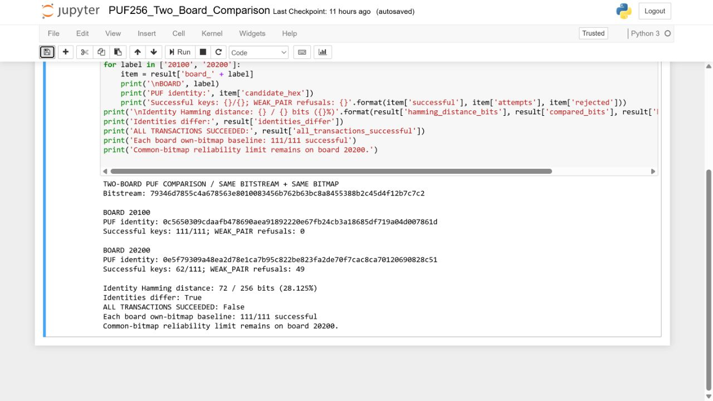

# 雙板實測結果（2026-11-13）

已確認這兩塊板在相同 FPGA 邏輯與相同配對選擇下，產生不同的 256-bit PUF 身份碼。**共同 bitmap 在第二板的可靠度不足，因此未達成全部交易成功。**

## 控制條件

兩板上傳相同七檔並驗證 SHA256。沒有重新合成、修改配置、調低 margin 或根據新 holdout 換配對。

- bit SHA256：`79346d7855c4a678563e8010083456b762b63bc8a8455388b2c45d4f12b7c7c2`
- HWH SHA256：`2cd50c158601bfadd18a1420298a87fee2520f820bcfe0d3da12df59e0a694c2`
- common plan SHA256：`a3530b72719b7b8c983a95f7a1afca6f3c71c2d46d406b32987236ffadb57346`
- 640 個 RO、320 組不重疊候選配對、選 256 組；每組量測五次取多數。每次樣本的絕對計數差至少 8，任何樣本太弱即拒絕。
- FCLK0 100 MHz、量測視窗 100000 cycles、warmup 1024 cycles；PYNQ 2.5 / Python 3.6.5。
- 16 個 16-bit SECDED 區塊、80-bit helper。此階段沒有 SHA3 或身分認證協定。

共用 320-bit bitmap（hex，bit p 對應 pair p；依遞增 pair ID 打包輸出）：

```text
feebfe3ffff7fbedfdfbe7fbbfbbeced7ffaf1fbbc37836dfbffbb7ff4ffeafd97bfffbdfbefdfff
```

## 選樣與獨立基準

每板先量測 32 次 reference × 320 pairs、128 次 training × 320 pairs，再對選中的 256 pairs 做 32 次 holdout，共 59392 列原始 count。第一板合格 288 組，第二板合格 293 組。各自 bitmap 的 100 次重建、1 次 abort/reset 後重建、10 次重新載入相同 bitstream 後重建，兩板均 111/111 成功，修正數皆零。

第一板原 bitmap 有 18 組未通過第二板 training，因此未拿它直接當共同選擇。兩板合格集合交集 266 組；依兩板 training 的最小 normalized gap，再依最小絕對 margin、pair ID 決定選出 256 組，先凍結後才執行新 holdout。排序不使用輸出位元方向、板間差異或新 holdout 結果。離線從套件內基準 CSV 重新 freeze，三個輸入檔逐位元組相同。

## 相同 bitmap 的實際身份碼

| 板子 | 實際 PL 註冊輸出（hex，256 bit） |
|---|---|
| 20100 | `0c5650309cdaafb478690aea91892220e67fb24cb3a18685df719a04d007861d` |
| 20200 | `0e5f79309a48ea2d78e1ca7b95c822be823fa2de70f7cac8ca70120690828c51` |

兩者 XOR 有 **72 個 1，Hamming distance 28.125%**。硬體註冊輸出與各自 training 參考一致；helper 由離線獨立重算 syndrome 核對。每筆成功重建的 32-byte little-endian 輸出 SHA256 均符合本板註冊資料。

| 共同 bitmap 檢查 | 20100 | 20200 |
|---|---:|---:|
| 新 raw holdout | 8192/8192 符合 | 8192/8192 符合 |
| holdout 最小絕對 count 差 | 11 | 10 |
| 一般重建 100 次 | 100 成功 | 52 成功、48 拒絕 |
| abort/reset 後 1 次 | 1 成功 | 1 成功 |
| 相同 bitstream reload 後 10 次 | 10 成功 | 9 成功、1 拒絕 |
| 合計 111 次 | **111 成功、0 拒絕** | **62 成功、49 拒絕** |
| 被接受但身份碼改變 | 0 | 0 |
| ECC 修正 word 合計 | 0 | 0 |

每次載入後先驗證七組暫存狀態歸零及實際 FCLK0，再從外部載入 bitmap/helper。Linux boot ID 不同，用於排除兩個網址其實指向同一個正在運行的 kernel；它不是永久晶片身份碼，也不參與 PUF。

## 第二板拒絕與診斷

嚴格模式第一次在 repeat index 18（第 19 次一般重建、PUF sequence 20）遇 `status=4 / WEAK_PAIR`，即停止並保留原始前綴。失敗後讀取診斷暫存器得到 pair 25；該交易沒有有效 key 輸出。

接著單獨對 pair 25 量測 256 次，計數差為 10～28，沒有重現低於 8 的弱樣本。PUF 內部該失敗交易的五筆 count 未保存，因此目前不能確定是哪筆數值或環境因素造成拒絕；不能據此宣稱已證明溫度或其他物理原因。

之後使用固定排程診斷程式接續剩餘次數，未自動重試、未更換 bitmap、未重註冊。原始 20 筆前綴及 hash 完整保留，新資料夾另外保存 111 次完整結果。49 次拒絕的診斷配對分布為 pair 25：1 次、pair 16：38 次、pair 2：10 次。成功交易全部仍為原身份碼。

第二板資料包含第一次失敗後的 256 次診斷暫停，因此不是不中斷的連續 111 次測試，也不是受控環境下的錯誤率估計。新 holdout 通過，不能保證後續五取樣交易都通過門檻。`WEAK_PAIR` 在 ECC 前拒絕；這批量測不能用來宣稱已實證 ECC 的修復能力。

## 結論與範圍

「這兩塊板的身份碼不同」已由相同邏輯、相同 bitmap 的實測證實。「共同 bitmap 在兩板都能穩定輸出」尚未通過。下一個可靠度改善方向是針對弱配對選樣與跨時間 margin 做新的訓練及獨立 holdout；本次失敗結果維持原樣，不用換樣或放寬門檻覆蓋。

72/256 是這兩塊板的一次板間距離，低於常用的理想 50% 參考；僅兩板不足以估計族群唯一性、獨立性或熵。256-bit 長度不等於已證明 256-bit 安全強度。本次未做多溫度、多電壓、斷電冷啟動或認證協定驗證。

`sample_results/two_board_comparison.json`：`comparison_verified=true` 表示原始紀錄一致性核對完成；`passed=false` 與 `all_transactions_successful=false` 明確保留共同 bitmap 可靠度失敗。截圖與原始 Notebook、CSV、JSON、ZIP 均隨套件保存。


