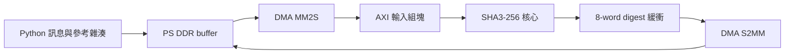

# 第一階段的設計與檔案

## 此階段的目標

用 Python 送入任意 byte message，讓 FPGA 的 SHA3-256 核心執行 padding、吸收與 permutation，透過 DMA 取回 digest。上板驗證以與 `hashlib.sha3_256()` 完全一致為通過條件。

## 以哪一份 RTL 為基準

來源為 `src/sysVerilog/01_RTL`，使用 `00_TESTBED/filelist.f` 中列出的 15 個 RTL 檔案。`baseline_manifest.json` 保存建立此版本時的 SHA-256，可執行 `python verify_baseline.py` 核對目前原始 RTL 是否與這份基準一致。`sim/baseline/` 保存當時的一般、注錯與跨 lane 測試。

FPGA 快照在 `rtl/core/`。其中兩個檔案做了功能相關的適配。

| 檔案 | 適配內容 |
|---|---|
| `sha3_ultra_low_power_top.sv` | state bank 接共同 `clk` 及下降沿已鎖存的 `write_mask_q`，取代 lane gated clocks |
| `keccak_state_bank.sv` | 每個 lane 在共同時脈上升沿、且 `lane_ce` 有效時寫入 |

下降沿的寫入來源、資料與遮罩鎖存仍參與 FPGA 版本的控制，因此需要檢查上升沿與下降沿之間的半週期時序。`sha3_low_power_gating.sv` 的實體 clock AND gate 由 clock enable 取代。此映射方式符合 FPGA 使用暫存器 CE 的做法。 [AMD gated-clock conversion](https://adaptivesupport.amd.com/s/article/982650?language=en_US)

`FT_ENABLE` 固定為 1，核心中的 parity/replay 邏輯啟用，外部注錯輸入固定為零。注錯驗證另由 `sim/baseline/PATTERN_FT.sv` 在模擬中執行。FPGA 上的電源消耗與 ASIC clock-gating 的功耗結果需分別量測。

## 檔案地圖

| 位置 | 用途 |
|---|---|
| `rtl/core/` | SHA-3 核心及 FPGA CE 適配 |
| `rtl/sha3_axis_top.sv` | AXI4-Stream 輸入組塊、協定檢查、輸出緩衝與封包 |
| `python/sha3_pynq.py` | 編碼訊息、DMA 傳輸、解析回覆、與 hashlib 比較 |
| `python/SHA3_Bringup.ipynb` | 可直接在實驗室 Jupyter 執行的 notebook |
| `sim/tb_sha3_axis.sv` | 真實 SHA-3 核心搭配 wrapper 的傳輸測試 |
| `sim/make_vectors.py`、`sim/vectors/` | hashlib 產生的輸入與預期結果 |
| `sim/run_sim.py` | Vivado Simulator 命令列測試入口 |
| `sim/baseline/` | 已複製的一般、注錯及跨 lane 測試與檔案雜湊 |
| `vivado/create_project.tcl` | 打包 SHA-3 IP、建立 PYNQ-Z2 專案與完整 Block Design |
| `vivado/open_project.tcl` | 載入附帶的板卡資料，再開啟既有專案 |
| `vivado/build_bitstream.tcl` | 執行 implementation、產生報告並檢查 setup/hold slack 後匯出 |
| `vivado/export_overlay.tcl` | 匯出同名 bit/hwh、Python driver 與 notebook |
| `vivado/check_synthesis.tcl` | 單獨綜合 SHA-3 IP，供需要時檢查資源 |
| `third_party/board_files/` | PYNQ-Z2 板卡定義與 DDR/PS preset |
| `third_party/board_sources.json` | 第三方來源、固定 commit 與各檔案 SHA-256 |
| `build/` | 本機生成的專案、模擬日誌、implementation 與 overlay，Git 忽略此目錄 |

板卡檔案取自 AMD/Xilinx 官方 XilinxBoardStore 的 `boards/TUL/pynq-z2/A.0`，固定 commit 為 `573a2975745ae136a9a72204ad02d5412bdaeb59`，授權隨附於 `third_party/XilinxBoardStore_LICENSE`。 [官方板卡庫](https://github.com/Xilinx/XilinxBoardStore/tree/573a2975745ae136a9a72204ad02d5412bdaeb59/boards/TUL/pynq-z2/A.0)

## AXI 封包

資料流寬度為 32 bits，每個 transfer 的 TKEEP 都是 `0xF`。一個 message 是一個 MM2S packet，可包含多個 block。每個 block 固定 35 words。

| Word | 內容 |
|---|---|
| 0 | header，`[7:0]` 為本區塊有效 byte 數，`[8]` 為最後區塊，`[31:9]` 為零 |
| 1–34 | 136 bytes 的資料，最後一塊不足的部分補零 |

非最後區塊的有效長度固定 136。最後區塊長度可以是 0–136。空訊息用長度 0 的最後區塊表示。136 的整數倍長度由核心自行產生額外 padding block。TLAST 僅在整個 message 的最後一個 payload word 有效。

例如 `b"abc"` 的 header 是 `0x00000103`，第一個 payload word 是 `0x00636261`，其餘 payload words 為零。SHA-3 padding 由核心產生。Python driver 只補齊傳輸所需的固定 136-byte 容器。

S2MM 固定回覆 9 words，也就是 36 bytes。

| Word | 內容 |
|---|---|
| 0 | `0x53480000` 表示成功 |
| 1–8 | digest，依每個 word 的 little-endian byte 順序串接即為標準 32-byte digest |

錯誤碼 `0x53480001` 表示 header 格式錯誤，`0x53480002` 表示 payload TKEEP/TLAST 錯誤，`0x53480003` 表示核心 digest word 數錯誤。錯誤回覆的 digest words 為零。尚未遇到 TLAST 的錯誤封包會先 drain 至封包尾。若上游永遠不送 TLAST，主機端會 timeout，接著用 `session.reset()` 重新下載 overlay 恢復。

wrapper 先將核心的八個輸出 words 全部保存，等 `hash_done` 後再送出 AXI 回覆。DMA 暫停時，回覆內容保持穩定。回覆完整送完才接受下一個 message。 [PYNQ DMA 與 TLAST](https://pynq.readthedocs.io/en/v2.7.0/pynq_libraries/dma.html)

## FPGA 設定選擇

本次預設 PS FCLK_CLK0 為 **25 MHz**，先以 40 ns 週期完成部署。這是 FPGA bring-up 的初始設定。後續若要升到 100 MHz，需要重新檢查半週期路徑、完成 implementation 並重跑上板測試。

DMA 採 simple mode，Read/Write 都啟用，Stream 和 memory data width 均為 32、burst 為 16、buffer length 為 26 bits、DRE 關閉。Address Width 使用 32，對應 PYNQ-Z2 的 Zynq-7000 位址空間。老師第 22 頁截圖為 64，本專案採用此處明列的 32-bit 設定。Python driver 以 1 MiB 作單次訊息上限。

PS M_AXI_GP0 負責控制 DMA，DMA 的兩個 memory masters 經 AXI interconnect 連到 S_AXI_HP0。PL 外部連接只有 PS 的 DDR 與 FIXED_IO，板卡 preset 和生成的 IP 約束負責這些介面及 FCLK。可在 implementation 的 timing report 查看實際 clock 與路徑。

## 接到後續 TRNG

完成本階段後，下一步建立原始噪聲來源、採樣器、原始資料匯出與健康測試。先由原始樣本估計熵，才能決定每次 SHA3-256 所需的輸入資料量與輸出規則。未來可以沿用核心的 block 輸入及 digest 緩衝邏輯，將資料來源接到採樣 FIFO。 [NIST SP 800-90B](https://doi.org/10.6028/NIST.SP.800-90B)

## 2026-11-09 系統檢查與發布

`sim/tb_sha3_system.sv` 將 PS VIP、實際生成的 BD、vendor DMA/interconnect/reset 與 SHA3 RTL 接在一起。測試 GP0 MMIO、reset assert/release、HP0 DDR 搬移、訊息邊界、錯誤封包恢復及停止 DMA 後 PL reset。輸入由 PS VIP DDR 模型提供；輸出在實際 PS HP0 接口以獨立 byte scoreboard 核對位址、5 個 beat、WSTRB、WLAST、BRESP、全部 9 個回覆 word 及第 10 個 guard word。此監看器不驅動 DUT。初次檢查時 vendor VIP 接受了 HP0 寫入，但 `read_mem` backdoor 仍讀到舊值；該模型儲存回讀限制尚未釐清，因此不將其宣稱為已通過 DDR 儲存回讀或 ARM/Linux 實測。

`sim/check_host.py` 使用官方 PYNQ v2.5 原始 HWH parser 與 DMA driver，模擬 MMIO/配置記憶體；它不是實板測試。測試正常訊息、傳輸逾時、啟動卡住、停止失敗保留 buffers、停止成功後重新載入與 bit/hwh 不匹配拒絕。

`python/sha3_pynq.py` 在碰觸硬體前檢查 release manifest、reset 常數與極性、clock、AXI 拓樸及 DMA 位址；載入時印出四個檢查點。DMA 啟動先有界檢查，再建立 PYNQ driver，避免原版建構子內無界等待。Python timeout 無法中斷已卡住的實體 MMIO。

`session.reset()` 先清兩個通道 RS 並確認 Halted，才釋放 buffer 及重新載入 PL。停止失敗會保留 buffer 並拋出錯誤。

`vivado/export_overlay.tcl` 先將候選檔案放在 `build/overlay_pending`，再以 `python/make_release.py` 確認系統模擬 PASS、HWH 及 RTL 來源雜湊匹配、PYNQ 2.5 檢查 PASS，最後才發布至 `build/overlay`。manifest 含 build_id、硬體檔雜湊與測試摘要，與另外四個檔案一起上傳。
